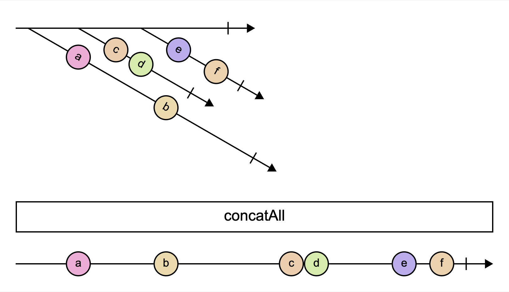

# Swirly


A marble diagram generator.

[![npm][npm-badge]][npm]

[npm-badge]: https://img.shields.io/npm/v/swirly.svg
[npm]: https://www.npmjs.com/package/swirly

## Example

Here's Swirly rendering the effect of the `concatAll` operator:



The image above was built from
[this marble diagram specification](examples/concatAll.txt).

Diagram specifications use an extension of the syntax used for
[RxJS marble testing](https://github.com/ReactiveX/rxjs/blob/fc3d4264395d88887cae1df2de1b931964f3e684/docs_app/content/guide/testing/marble-testing.md).
Please consult the [examples](examples.md) to learn how to create diagrams.

## Web Version

You can use Swirly in your browser at
[**swirly.tmdpw.eu**](https://swirly.tmdpw.eu/).

The Web version allows you to edit diagram specifications in real time and
export them to an SVG or a PNG image.

## CLI Version

Swirly is also available as a command-line utility. To run it, you need
[Node.js](https://nodejs.org/) 22 or later.

To install Swirly on your machine, just install the `swirly` npm package:

```bash
npm install -g swirly
```

Next, create `diagram.txt` with your diagram specification. Take a look at the
[examples](examples/) to learn about the expected syntax.

You can then generate an SVG image from the specification by simply running:

```bash
swirly diagram.txt diagram.svg
```

Swirly can also output PNG images. Since PNG is a raster image format, you may
want to increase the resolution to get a higher-quality result. You can do so by
passing `--scale` followed by a percentage. For example, this will render the
image at twice its original size:

```bash
swirly --scale=200 diagram.txt diagram.png
```

## Author

[Tim De Pauw](https://tmdpw.eu)

## License

MIT
